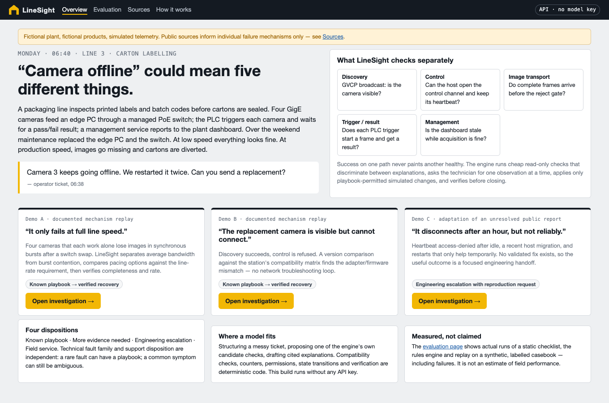
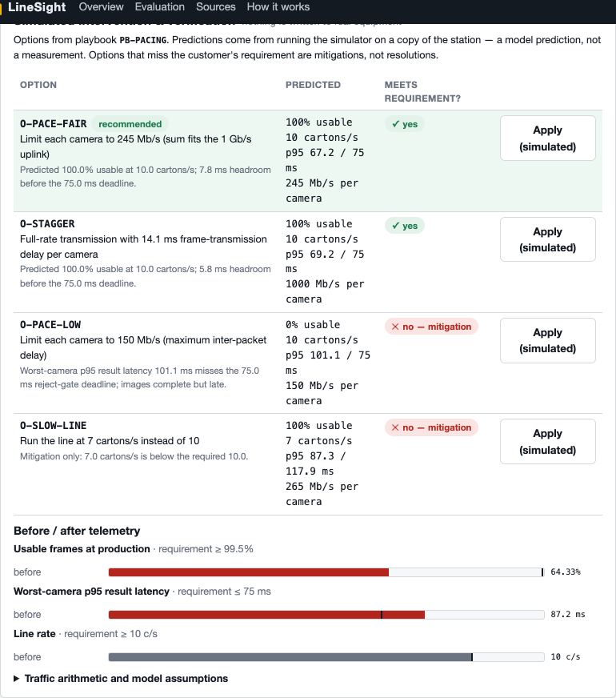
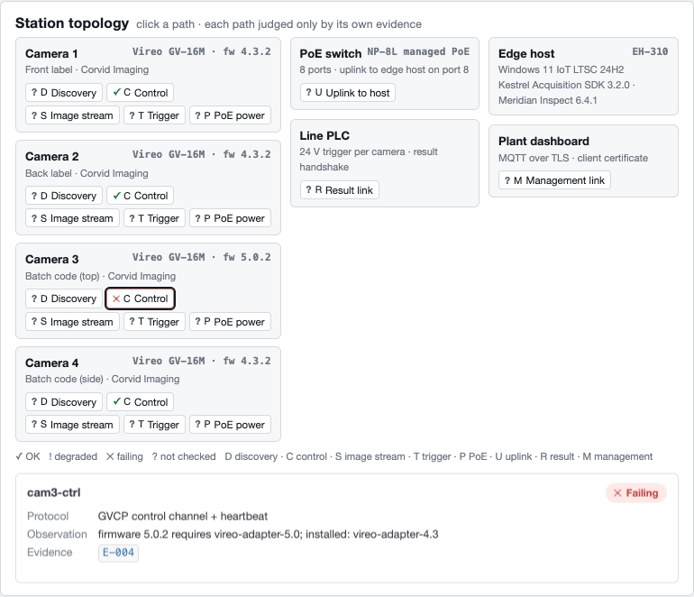
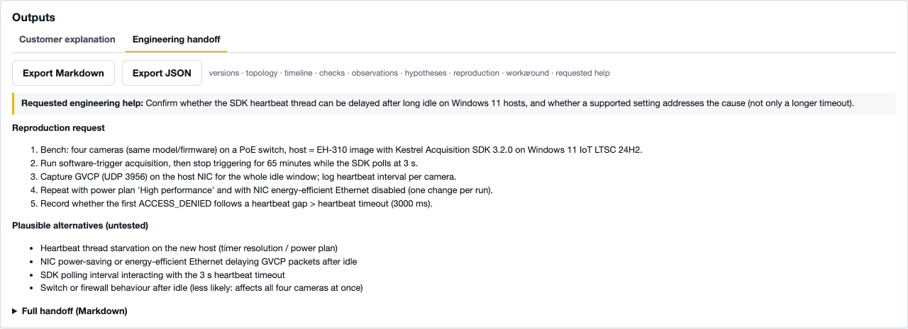

# LineSight

**Evidence-led triage for industrial machine-vision incidents.** A portfolio project. The plant, its products and its telemetry are fictional and simulated.

> **Monday, 06:40, Line 3.** A contract-packaging line inspects printed labels and batch codes before cartons are sealed. Four GigE cameras feed an edge PC through a managed PoE switch. The PLC triggers each camera and waits for a pass/fail result, and a management service reports to the plant dashboard. Over the weekend, maintenance replaced the edge PC and the switch. At low speed the line looks healthy. At production speed, images go missing and cartons are diverted to manual inspection.
>
> The ticket says: *"Camera 3 keeps going offline. We restarted it twice. Can you send a replacement?"*

"Offline" could mean five different things: discovery failed, control access failed, image transport failed, a trigger never arrived, or the dashboard is stale while acquisition is fine. LineSight is the first-line support engineer's tool for working out which one it is. It runs cheap read-only checks that tell causes apart and asks the technician for one observation at a time. It resolves routine faults through scoped playbooks and verifies the recovery before closing. When a fault needs engineering, it writes a cited handoff.



## Three flagship demos

| Demo | What happens | Outcome |
|---|---|---|
| **A: "It only fails at full line speed."** | Each camera is clean when it runs alone, and resend counters were already elevated at low speed. Synchronous bursts overflow the uplink buffer of the replacement switch. Four pacing options are predicted against the line-rate requirement. Running the line slower is labelled a mitigation. | Known playbook, verified at 10 cartons/s |
| **B: "The replacement camera is visible but cannot connect."** | Discovery succeeds and control is refused. The compatibility matrix shows firmware 5.0.2 needs an adapter that isn't installed. There is no network troubleshooting loop. | Known playbook, verified in 4 checks (Demo A needs 7) |
| **C: "It disconnects after an hour, but not reliably."** | All cameras answer heartbeats with access-denied after an idle gap following a host migration. Restarts help only temporarily. The documented crash-lock mechanism is ruled out. | Engineering escalation with a reproduction request |





## How it works

The engine is an inspectable decision graph over persistent case state. It is not a long prompt.

1. **Intake.** The ticket is untrusted text. A lexicon parser, a stored replay fixture or (optionally) a model turns it into a fixed schema: reported symptom groups, devices, claims and requested actions. Claims stay *customer assertions* until evidence agrees or disagrees.
2. **Evidence and facts.** Read-only probes against the simulated station return evidence records with provenance, capture time, scope, parser version and a stable id. Deterministic code derives named facts. Stale or unavailable evidence yields no fact.
3. **Rules.** [`rules.yaml`](backend/linesight/rules/rules.yaml) is versioned and validated at start-up. Each hypothesis has trigger symptoms, support, contradict and corroborate predicates, a playbook or a disposition, escalation and handoff requirements, and sources. Status is *supported*, *contradicted* or *untested*. There are no invented probabilities.
4. **Next check.** Score = severity-weighted rules tested plus open symptom readings, divided by (1 + operator effort + 2 × production disruption). Checks can be blocked by a prerequisite, a missing test window or the budget. Irrelevant checks are skipped with a reason.
5. **Disposition.** The four support dispositions are *known playbook*, *more evidence needed*, *engineering escalation* and *field service*. They are independent of the fault family. "No fault reproduced" is kept separate from "no matching playbook". Repeated temporary recoveries escalate, and so do failed verification and version combinations outside the matrix.
6. **Intervention and verification.** Only actions the playbook allows are possible. Options are predicted on a copy of the simulator, and the chosen one is applied in simulation. Fresh probes must then meet the customer's requirements: usable frames, the reject-gate deadline, line rate, control and PLC results.

Details: [docs/architecture.md](docs/architecture.md).

### Where the model fits

| A model may | Deterministic code does |
|---|---|
| Structure a messy ticket into the fixed schema | Compatibility checks, counter arithmetic, facts |
| Propose one of the engine's own candidate checks when scores tie | Rule status, next-check ranking, state transitions |
| Draft customer and engineer text that cites existing evidence ids | Permissions, interventions, verification |

Model outputs are validated. A timeout, refusal, schema error or missing citation falls back to the deterministic parser or template, and the fallback is recorded in the trace. Credentials stay on the server. The live mode uses `claude-opus-5-5` by default (override with `LINESIGHT_MODEL`). **Replay mode is labelled:** the stored fixtures for the three demo tickets are *hand-authored* to show the interface, and they are not model output. `python -m linesight.llm.record` captures real model outputs, labelled with the model and date, if you have a key.

## Run it

Prerequisites: Python ≥ 3.10 and Node ≥ 20.

```bash
python -m venv .venv && . .venv/bin/activate
```
```bash
pip install -e ".[dev]"
```
```bash
uvicorn linesight.api:app --app-dir backend --port 8000
```
In a second terminal:
```bash
npm --prefix frontend ci && npm --prefix frontend run dev
```
Open http://localhost:5173. Without the API, the same UI runs as a **static replay** of recorded engine runs.

Docker (API and built UI on one port; the key is optional):

```bash
docker compose up --build
```

Tests and evaluation (no credentials needed):

```bash
pytest -q
```
```bash
python -m linesight.eval.run --out frontend/public/data/eval.json && python -m linesight.eval.report_md
```
```bash
npm --prefix frontend run test:e2e
```

### Deployment

* **GitHub Pages** hosts only the static replay build ([`.github/workflows/pages.yml`](.github/workflows/pages.yml), manual trigger). It cannot run the Python API.
* **API** deployment is optional: the Dockerfile runs anywhere that runs a container. No secrets are bundled. Set `ANTHROPIC_API_KEY` on the server to enable live mode.
* Nothing in this repository publishes or pushes anything by itself.

## Measured results (synthetic)

These figures come from `python -m linesight.eval.run` at rules version 2026.11.3 ([full table and failure list](docs/evaluation-results.md)). The benchmark has 44 cases: 3 demos, 17 dev, 14 held-out with other configurations, seeds and fault combinations, and 10 paraphrased tickets written after the lexicon was frozen.

| Baseline | Correct disposition | Cause named | Missed escalations | Unsupported confident diagnoses | Verified recovery | Mean checks |
|---|---|---|---|---|---|---|
| Static checklist (fixed order, generic fixes) | 29 / 44 | 2 / 44 | 13 | 37 | 2 / 28 | 9 |
| Rules engine, no model | 44 / 44 | 42 / 44 | 0 | 0 | 28 / 28 | 5.2 |
| Rules + replay | 44 / 44 | 42 / 44 | 0 | 0 | 28 / 28 | 5.2 |
| Rules + live model | not run (no credentials in this environment) | | | | | |

**How to read this honestly:**

* The casebook and the rules have the same author, so the rules engine's score shows internal consistency. It is a regression suite, not evidence of field accuracy, and it says nothing about support-time savings.
* The two rules-engine misses are real: a ticket whose wording the lexicon does not map (a second fault is missed), and a cable-plus-burst double fault where only the cable is found.
* **Does the model earn its place here? Not on these metrics.** Replay equals rules because fixtures exist only for the demo tickets, and live runs were not possible. Most of the discrimination comes from read-only checks rather than ticket wording. Even the paraphrased tickets were dispositioned correctly, because the engine falls back to the broad "offline" reading and checks more. The value a model might add is in messier intake, device naming by role, and the quality of explanations. This benchmark measures those least.
* The checklist baseline runs every check, takes the first matching line and applies a generic fix. It never escalates, which is where most of its errors come from.

## Sources

The casebook mirrors mechanisms from six public sources: Basler packet-loss guidance, Cognex adapter matching, Basler crash/heartbeat behaviour, Aurora Vision known issues, Cognex acquisition-error variants, and the open pypylon issue #863. See [`sources.yaml`](backend/linesight/rules/sources.yaml) or the in-app Sources page. Each entry has the retrieval date, evidence type, a paraphrase, applicability, the documented outcome and open questions. Each fixture is labelled as a *documented mechanism replay*, an *adaptation of an unresolved report* or *fully synthetic*. No vendor relationship is implied, and the compatibility matrix is fictional.

## Limitations

* The transport model is a small burst-queue model with stated assumptions. It is not GigE Vision and proves nothing about real hardware.
* There is one station template and three customer configurations. Technician answers are simulated from the hidden state.
* The scoring heuristic is hand-set and its weights are not calibrated against real tickets. There is no real ticket distribution, so the brief's "small set of recurring patterns" hypothesis is demonstrated, not tested.
* Multi-fault handling is shallow. The engine stops when every observed symptom is explained, so a fault that one ambiguous symptom hides can be missed (see the failures above).
* The live model path is implemented and unit-tested with fakes, but it has not been run against the API from this environment.

## Tradeoffs

* **Bounded context.** One packaging-line station rather than a general device-support chatbot. This made every check, playbook and verification concrete.
* **Decision graph over free-form diagnosis.** Each step is reproducible and explainable. Anything outside the rules becomes an escalation rather than a guess.
* **Deterministic enforcement.** Permissions and verification live in code, so a prompt injection has nothing to unlock.
* **Useful abstention.** A cited handoff with a reproduction request counts as a successful outcome.
* **Verification before closure.** A predicted fix never closes a case, and a working-but-slower line is recorded as a mitigation.

## Layout

```
backend/linesight/   models · station · simulator/ · engine/ · rules/ (rules.yaml, sources.yaml) · casebook/ · llm/ · eval/ · api.py
frontend/            React + TypeScript UI, Playwright tests, static replay data
tests/               pytest behaviour tests
docs/                architecture, evaluation results, sample evidence bundles and handoffs, screenshots
```
